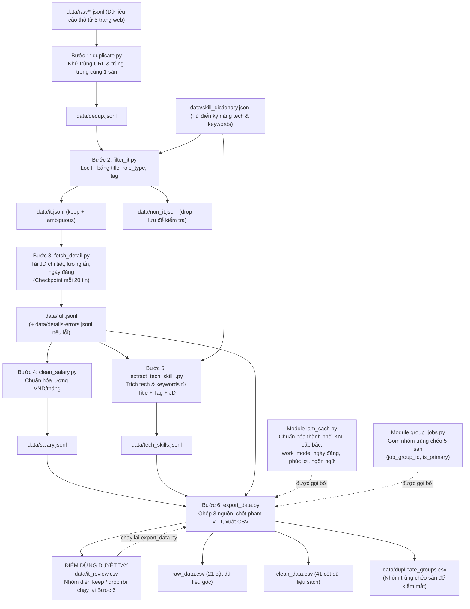

# Tài Liệu Giải Thích Pipeline Xử Lý Dữ Liệu (`pipline/`)

> **Mục đích tài liệu:** Giúp mọi thành viên trong nhóm (kể cả người không trực tiếp viết code cào/làm sạch) nắm trọn **ý tưởng cốt lõi**, **từng bước xử lý**, **từng hàm của từng file và từng trang web**, cũng như **thứ tự chạy & các điểm dừng kiểm tra** của toàn bộ thư mục `pipline/`.

---

## Mục Lục

1. [Tổng quan thư mục `pipline/`](#1-tổng-quan-thư-mục-pipline)
2. [Tư duy cốt lõi: "Rác vào → Rác ra" (Garbage In → Garbage Out)](#2-tư-duy-cốt-lõi-rác-vào--rác-ra-garbage-in--garbage-out)
3. [Sơ đồ luồng dữ liệu & Thứ tự từng bước chạy (kèm các điểm dừng)](#3-sơ-đồ-luồng-dữ-liệu--thứ-tự-từng-bước-chạy-kèm-các-điểm-dừng)
4. [Giải thích chi tiết từng file & từng hàm](#4-giải-thích-chi-tiết-từng-file--từng-hàm)
   - [4.1. `duplicate.py` — Khử trùng lặp trong cùng trang web](#41-duplicatepy--khử-trùng-lặp-trong-cùng-trang-web)
   - [4.2. `filter_it.py` — Lọc tin IT & loại tin rác không phải IT](#42-filter_itpy--lọc-tin-it--loại-tin-rác-không-phải-it)
   - [4.3. `fetch_detail.py` — Tải JD chi tiết & hàm xử lý cho từng trang web](#43-fetch_detailpy--tải-jd-chi-tiết--hàm-xử-lý-cho-từng-trang-web)
   - [4.4. `clean_salary.py` — Chuẩn hóa lương về VND/tháng](#44-clean_salarypy--chuẩn-hóa-lương-về-vndtháng)
   - [4.5. `extract_tech_skill_.py` — Trích xuất kỹ năng công nghệ & từ khóa](#45-extract_tech_skill_py--trích-xuất-kỹ-năng-công-nghệ--từ-khóa)
   - [4.6. `lam_sach.py` — Bộ hàm chuẩn hóa mọi trường còn lại (Module thư viện)](#46-lam_sachpy--bộ-hàm-chuẩn-hóa-mọi-trường-còn-lại-module-thư-viện)
   - [4.7. `group_jobs.py` — Gom nhóm tin trùng chéo trang web (Module thư viện)](#47-group_jobspy--gom-nhóm-tin-trùng-chéo-trang-web-module-thư-viện)
   - [4.8. `export_data.py` — Ghép tổng hợp, chốt phạm vi IT & xuất file nộp](#48-export_datapy--ghép-tổng-hợp-chốt-phạm-vi-it--xuất-file-nộp)
5. [Bảng tổng hợp đặc thù xử lý của 5 trang web tuyển dụng](#5-bảng-tổng-hợp-đặc-thù-xử-lý-của-5-trang-web-tuyển-dụng)
6. [Hướng dẫn nhanh cho thành viên làm EDA & Mô hình (Modeling)](#6-hướng-dẫn-nhanh-cho-thành-viên-làm-eda--mô-hình-modeling)

---

## 1. Tổng quan thư mục `pipline/`

Sau khi bước cào dữ liệu (Phase 1) thu thập danh sách tin tuyển dụng thô từ **5 trang web** (`ITviec`, `TopDev`, `TopCV`, `VietnamWorks`, `LinkedIn`) lưu vào `data/raw/*.jsonl`, dữ liệu lúc này còn rất thô, lẫn nhiều tin không phải IT, trùng lặp, thiếu mô tả chi tiết (JD) và mỗi trang ghi lương/địa điểm/ngày đăng một kiểu khác nhau.

Thư mục `pipline/` gồm **8 file Python chính** đảm nhận toàn bộ quá trình từ dữ liệu thô đến 2 file nộp chuẩn (`raw_data.csv` và `clean_data.csv`):

| Loại file | Danh sách file | Ghi chú cho nhóm |
| :--- | :--- | :--- |
| **6 file chạy lệnh trực tiếp** (`python -m pipline.<tên>`) | `duplicate.py`, `filter_it.py`, `fetch_detail.py`, `clean_salary.py`, `extract_tech_skill_.py`, `export_data.py` | Chạy lần lượt theo đúng thứ tự bước ở Mục 3. |
| **2 file module thư viện thuần hàm** (không chạy trực tiếp) | `lam_sach.py`, `group_jobs.py` | Tự động được `export_data.py` gọi vào (và có thể `import` vào Notebook để minh họa trước/sau khi báo cáo). |
| **File sao lưu & bộ nhớ đệm** (bỏ qua) | `*.bak*`, `__pycache__/` | Chỉ là bản sao lưu cũ trong lúc phát triển và file cache Python, **không dùng khi chạy**. |

---

## 2. Tư duy cốt lõi: "Rác vào → Rác ra" (Garbage In → Garbage Out)

Trong phân tích dữ liệu và học máy, dù biểu đồ vẽ có đẹp hay mô hình có phức tạp đến đâu, **nếu dữ liệu đầu vào bị bẩn ("rác") thì kết quả phân tích và dự đoán chắc chắn sai lệch ("rác ra")**.

Toàn bộ thiết kế của `pipline/` xoay quanh việc **chặn rác ở đúng thời điểm, xử lý minh bạch, không đoán mò và luôn truy vết được nguồn gốc**. Dưới đây là 8 loại "rác" thực tế gặp phải khi cào 5 trang tuyển dụng Việt Nam và cách pipeline trị từng loại:

| # | Loại "rác" ngoài thực tế | Hậu quả nếu KHÔNG xử lý ("Rác ra") | Cách `pipline/` giải quyết |
| :-: | :--- | :--- | :--- |
| **1** | **Tin đăng trùng lặp** (trùng URL, đăng lại nhiều lần trên cùng sàn, hoặc 1 công ty đăng cùng 1 vị trí lên cả ITviec, TopCV, LinkedIn). | Tốn thời gian tải JD lặp lại; số lượng việc làm bị thổi phồng; thống kê lương & kỹ năng bị lệch theo các công ty spam tin. | Tách 2 tầng: `duplicate.py` xóa trùng **trong cùng sàn** ngay từ đầu; `group_jobs.py` **gom nhóm trùng chéo sàn** ở bước cuối bằng Fuzzy Matching + Union-Find (không xóa mà gắn `is_primary`). |
| **2** | **Tin sai ngành không phải IT** (Sales IT, HR/Recruiter tuyển IT, Kế toán công ty phần mềm, lập trình máy CNC/PLC cơ khí, Graphic Designer dùng Photoshop). | Kéo sai mặt bằng lương IT (lương Sales/HR/CNC lẫn vào Dev); làm nhiễu bảng xếp hạng kỹ năng và mô hình dự đoán. | Lọc 2 tầng thận trọng: `filter_it.py` chặn chắc chắn tin không phải IT, đưa tin mơ hồ vào `ambiguous` → `export_data.py` kiểm tra thêm tech trong JD → ca vẫn khó đưa ra `it_review.csv` để **nhóm đọc tay**. |
| **3** | **Tin thiếu nội dung / bị cắt cụt / giấu lương** (ITviec/TopDev ghi `"Sign in to view salary"`, VietnamWorks cắt JD bằng dấu `"..."`, TopDev từng bị cắt ở 6000 ký tự). | Mất hàng loạt dữ liệu lương; trích kỹ năng bị rỗng; phân tích thiếu mục Yêu cầu & Phúc lợi. | `fetch_detail.py` mở từng trang chi tiết, bóc lương ẩn từ JSON-LD, bấm nút `"Xem đầy đủ"` ở VietnamWorks, gọi Voyager API cho LinkedIn, và tự nhận diện tin bị cụt để tải lại. |
| **4** | **Lương viết đủ mọi kiểu & giá trị giả** (`"15 - 20 triệu"`, `"2,000 USD"`, lương/năm lẫn lương/tháng, VietnamWorks ghi nhầm `"$ 30tr-50tr"`, giá trị rác `"$ 1-1/tháng"`, `"Thỏa thuận"`). | Nếu điền `"Thỏa thuận" = 0` hay gộp lương năm với lương tháng thì lương trung bình thị trường sai hoàn toàn. | `clean_salary.py` quy đổi về `VND/tháng` (`1 USD = 25.000`, lương năm `/ 12`), chặn khoảng hợp lệ `1 – 300 triệu/tháng`, **tuyệt đối không điền 0**, gắn 8 trạng thái `salary_status` và cứu lương từ JD theo luật cực chặt. |
| **5** | **Kỹ năng viết nhiều kiểu & bẫy trùng từ** (`ReactJS`/`React.js`; chữ `"c"`, `"r"`, `"go"`, `"express"` trùng văn bản thường; bỏ dấu khiến `"ai"`, `"sắp"`, `"excel"`, `"solid"` trùng tiếng Việt/Anh). | Đếm sai Top công nghệ (ví dụ `"sắp xếp"` thành `SAP`, `"Ai cũng biết"` thành `AI`, `"go-live"` thành ngôn ngữ `Go`). | `extract_tech_skill_.py` chuẩn hóa theo từ điển `skill_dictionary.json`; bắt buộc `C/R/Go/Express` phải đứng trong danh sách kỹ năng có dấu ngăn; bắt buộc `AI/SAP/SOLID/Excel` phải viết đúng chữ HOA trên văn bản gốc. |
| **6** | **Nhiễu ngữ cảnh trong văn bản** (`"ProTập đoàn FPT"` ở TopCV; tuổi thành lập công ty nhầm thành số năm kinh nghiệm; `"Product Manager"` nhầm thành cấp Lead; `"hybrid cloud"` nhầm làm việc Hybrid; bỏ dấu `"thưởng"` = `"thường"`). | Một công ty bị tách làm 2; Fresher bị tính thành 15 năm kinh nghiệm; PM/PO bị đẩy hết lên Lead; tỉ lệ Hybrid và Phúc lợi thưởng bị phóng đại. | `lam_sach.py` thiết kế luật ngữ cảnh riêng cho từng bẫy: gỡ huy hiệu `Pro`, ưu tiên mục Yêu cầu & chặn từ khóa tuổi công ty, tách riêng nhóm `pm_po`, chặn từ kỹ thuật đi sau `hybrid`, giữ nguyên dấu tiếng Việt khi tìm phúc lợi. |
| **7** | **Sai lệch mốc dữ liệu từng trang** (ITviec `monthsOfExperience` chỉ có 3 mốc `10/37/61` tháng; nếu chia nguyên `10 // 12 = 0` thì mọi tin 1 năm kinh nghiệm biến thành Fresher!). | Phân bố cấp bậc Fresher phình to bất thường, sai lệch toàn bộ biểu đồ lương theo cấp bậc. | `lam_sach.py` ưu tiên đọc năm kinh nghiệm từ JD trước rồi mới lấy mốc ITviec và dùng `round(10 / 12) = 1` năm. |
| **8** | **Rò rỉ nhãn (Data Leakage) khi làm mô hình AI/ML** (dùng `exp_min_years` để suy ra `seniority`, rồi lại lấy `exp_min_years` làm đầu vào để dự đoán `seniority`!). | Mô hình đạt điểm giả tạo (gần 100%) nhưng thực tế là đang "học thuộc luật tạo nhãn". | Mọi cột suy diễn đều đính kèm cột nguồn (`seniority_source`, `exp_source`, `work_mode_source`, `posted_date_source`, `salary_source`, `it_decision_source`) để bước Modeling biết mà loại trừ đặc trưng gây rò rỉ. |

> **Nguyên tắc vàng xuyên suốt pipeline:**
> 1. **Ô trống (`None` / `""`) = không biết**, **KHÔNG BAO GIỜ tự điền số `0`** hay tự đoán `Onsite` khi nguồn không cung cấp. Phân biệt rõ `None` (không có dữ liệu) với `[]` / `0` (có dữ liệu nhưng kết quả đếm bằng 0).
> 2. **Ghi file nguyên tử (Atomic Write):** Hầu hết các bước đều ghi ra file tạm trước rồi mới `.replace()` sang file đích → dù đang chạy bị mất điện hay bấm `Ctrl+C` cũng **không bao giờ làm hỏng file dữ liệu cũ**.
> 3. **Giữ nguyên bản gốc song song với bản sạch:** Xuất đủ `raw_data.csv` và `clean_data.csv` liên kết qua `job_uid` để bất cứ lúc nào cũng kiểm chứng ngược được.

---

## 3. Sơ đồ luồng dữ liệu & Thứ tự từng bước chạy (kèm các điểm dừng)

### 3.1. Sơ đồ tổng thể đường ống dữ liệu

### 3.2. Bảng tóm tắt thứ tự chạy từng bước

> **Lưu ý quan trọng:** Mọi lệnh đều phải chạy từ **thư mục gốc của dự án** (`vietnam-it-job-market-analysis/`), **KHÔNG** `cd` vào trong `pipline/` (vì code dùng dạng gói `python -m pipline.<ten_file>`).

| Thứ tự | File | Lệnh chạy (từ thư mục gốc) | Đầu vào | Đầu ra | Ghi chú / Điểm dừng |
| :-: | :--- | :--- | :--- | :--- | :--- |
| **1** | `duplicate.py` | `python -m pipline.duplicate` | `data/raw/*.jsonl` | `data/dedup.jsonl` | Chạy nhanh (vài giây). |
| **2** | `filter_it.py` | `python -m pipline.filter_it` | `data/dedup.jsonl`, `data/skill_dictionary.json` | `data/it.jsonl`, `data/non_it.jsonl` | **Điểm dừng kiểm tra 1:** Xem bảng `keep/ambiguous/drop` và lướt qua `non_it.jsonl` xem có lỡ loại nhầm tin IT nào không. |
| **3** | `fetch_detail.py` | `python -m pipline.fetch_detail` | `data/it.jsonl` | `data/full.jsonl`, `data/details-errors.jsonl` | **Bước lâu nhất & có checkpoint:** Tự lưu mỗi 20 tin. Chạy không `--headless` để có thể bấm xác minh Cloudflare (chờ tối đa 180s). Có thể chạy riêng từng sàn bằng `--site itviec`. |
| **4** | `clean_salary.py` | `python -m pipline.clean_salary` | `data/full.jsonl` | `data/salary.jsonl` | **Điểm dừng kiểm tra 2:** Kiểm tra thống kê 8 trạng thái lương và 10 ví dụ `unknown` in ra màn hình. *(Bước 4 & 5 độc lập, chạy cái nào trước cũng được.)* |
| **5** | `extract_tech_skill_.py` | `python -m pipline.extract_tech_skill_` | `data/full.jsonl`, `data/skill_dictionary.json` | `data/tech_skills.jsonl` | **Điểm dừng kiểm tra 3:** Xem Top 15 tech & Top 10 keyword in ra màn hình để phát hiện nếu có từ bị bắt nhầm. |
| **6a** | `export_data.py` *(chạy lần 1)* | `python -m pipline.export_data` | `data/full.jsonl`, `data/salary.jsonl`, `data/tech_skills.jsonl` | `data/it_review.csv`, `raw_data.csv`, `clean_data.csv`, `data/duplicate_groups.csv` | **ĐIỂM DỪNG QUAN TRỌNG (Duyệt tay):** Mở `data/it_review.csv`, đọc cột `title` + `jd_dau`, điền `keep` hoặc `drop` vào cột `quyet_dinh`, lưu lại dạng **CSV UTF-8 (dấu phẩy)** rồi **đóng Excel**. Đồng thời kiểm tra mắt file `data/duplicate_groups.csv`. |
| **6b** | `export_data.py` *(chạy lần 2 — chốt)* | `python -m pipline.export_data` | 3 file trên + `data/it_review.csv` đã điền tay | `raw_data.csv`, `clean_data.csv` **(bản hoàn chỉnh để nộp)** | Các tin bạn đánh `drop` sẽ bị loại sạch khỏi cả 2 file CSV nộp; quyết định tay luôn được giữ an toàn. |

### 3.3. Khi nào cần chạy lại từ bước nào? (Để không tốn công chạy lại cả pipeline)

- **Chỉ sửa file duyệt tay `data/it_review.csv` hoặc sửa code trong `lam_sach.py` / `group_jobs.py` / `export_data.py`:**
  → Chỉ cần chạy lại **Bước 6** (`python -m pipline.export_data`).
- **Chỉ thêm/sửa kỹ năng trong `data/skill_dictionary.json`:**
  → Chạy lại **Bước 5** (`extract_tech_skill_.py`) → **Bước 6** (`export_data.py`). *(Nếu muốn áp dụng từ điển mới cho cả khâu lọc IT đầu vào thì chạy lại từ Bước 2 → 3 → 4 → 5 → 6; yên tâm Bước 3 có checkpoint nên tin đã tải JD sẽ không phải tải lại!)*
- **Chỉ sửa luật đọc lương trong `clean_salary.py`:**
  → Chạy lại **Bước 4** (`clean_salary.py`) → **Bước 6** (`export_data.py`).
- **Tải bổ sung tin lỗi ở một sàn cụ thể (ví dụ `topcv` bị lỗi mạng):**
  → Chạy `python -m pipline.fetch_detail --site topcv` → rồi chạy lại **Bước 4, 5, 6** để đồng bộ số dòng giữa 3 file `.jsonl`.

---

## 4. Giải thích chi tiết từng file & từng hàm

---

### 4.1. `duplicate.py` — Khử trùng lặp trong cùng trang web

- **Vai trò ngắn gọn:** "Người gác cổng đầu tiên" — gộp toàn bộ file cào thô `data/raw/*.jsonl` thành 1 file `data/dedup.jsonl` không còn tin trùng trong cùng một trang web.
- **Vì sao file này cần thiết?**
  - Khi cào nhiều trang kết quả (pagination) hoặc nhiều từ khóa tìm kiếm, cùng một tin tuyển dụng sẽ xuất hiện lặp đi lặp lại. Ngoài ra, nhà tuyển dụng hay đăng lại y hệt một vị trí trên cùng một sàn để đẩy tin lên đầu.
  - Khử trùng ngay trước bước `fetch_detail.py` giúp tiết kiệm rất nhiều thời gian tải trang, giảm nguy cơ bị chặn IP/Cloudflare, và giữ cho tập dữ liệu sạch ngay từ đầu.
- **Ý tưởng thiết kế nổi bật:**
  1. **Chỉ khử trùng trong cùng một trang web, GIỮ tin trùng giữa các trang khác nhau:** Nếu FPT đăng cùng 1 vị trí trên cả ITviec và TopCV, cả hai đều được giữ lại vì mỗi sàn cung cấp các trường bổ trợ khác nhau (ITviec có `work_model`, TopCV có số năm kinh nghiệm rõ). Việc gom nhóm trùng *chéo sàn* sẽ làm ở cuối cùng (`group_jobs.py`).
  2. **Không giữ bừa dòng đầu tiên — chọn dòng "giàu thông tin hơn":** Khi 2 tin trên cùng 1 trang trùng `(site, company, title)`, ưu tiên giữ bản có mô tả `description`, nếu hòa nhau thì giữ bản điền nhiều cột hơn.
- **Đã làm gì trong file?**
  1. Đọc toàn bộ các file `*.jsonl` trong `data/raw/`.
  2. Khử trùng chính xác theo `job_url`.
  3. Khử trùng nội bộ trong từng sàn theo khóa `(site, company chuẩn hóa, title chuẩn hóa)`, dùng `richer()` chọn bản tốt hơn.
  4. Ghi sạch ra `data/dedup.jsonl`.

#### Giải thích từng hàm trong `duplicate.py`

| Tên hàm | Đầu vào → Đầu ra | Giải thích dễ hiểu |
| :--- | :--- | :--- |
| `norm(s)` | Chuỗi bất kỳ → Chuỗi sạch chữ thường | Hạ chữ thường, đổi mọi dấu câu thành khoảng trắng, gộp các dấu cách thừa. Ví dụ `"FPT Software (HCM)!"` → `"fpt software hcm"`. |
| `key_of(row)` | 1 dòng tin (`dict`) → Chuỗi khóa | Tạo khóa nhận diện trùng trong cùng sàn dạng `"site\|\|norm(company)\|\|norm(title)"`. |
| `richer(a, b)` | 2 dòng tin trùng khóa → 1 dòng tốt hơn | So sánh 2 bản ghi trùng: bản nào có `description` (không rỗng) thì thắng ngay; nếu cả hai đều có (hoặc cùng không có) thì đếm số trường có giá trị (khác `None`, `""`, `[]`), bản nào nhiều thông tin hơn được giữ lại. |
| `main()` | Tham số `--raw`, `--out` → File `data/dedup.jsonl` | Điều phối đọc file thô → lọc trùng URL → lọc trùng theo `key_of()` + `richer()` → xóa file cũ (nếu có) và ghi file mới. |

---

### 4.2. `filter_it.py` — Lọc tin IT & loại tin rác không phải IT

- **Vai trò ngắn gọn:** "Bộ sàng lọc sơ bộ" — phân loại mọi tin thành 3 nhóm `keep` (chắc chắn IT), `ambiguous` (nghi ngờ/cần xem thêm JD), và `drop` (chắc chắn không phải IT) chỉ dựa vào `title`, `role_type` và `skills` (tag), **không cần đọc JD và không dùng LLM**.
- **Vì sao file này cần thiết?**
  - Các sàn tổng hợp như TopCV, VietnamWorks, LinkedIn thường trả về rất nhiều tin ngoài ngành khi tìm kiếm: *Sales IT, IT Recruiter, HR, Marketing, Kế toán*, hay *Lập trình máy CNC/PLC* (cơ khí, không phải phần mềm).
  - Loại bỏ sớm các tin chắc chắn là rác giúp Bước 3 (`fetch_detail.py`) không mất công tải hàng trăm trang JD vô nghĩa.
- **Ý tưởng thiết kế nổi bật:**
  1. **Triết lý "Thà nghi ngờ còn hơn bỏ sót":** Chỉ `drop` những tin chắc chắn sai ngành hoặc không có chút tín hiệu IT nào. Những chức danh nửa nạc nửa mỡ (`Engineer`, `Analyst`, `QA`, `QC`, `BA`, `PM`, hoặc chỉ có tag tech) được gán `ambiguous` và **vẫn giữ vào `data/it.jsonl`** để sau khi tải JD xong mới quyết định cuối cùng ở `export_data.py`.
  2. **Chặn chức năng không phải IT TRƯỚC khi tìm từ khóa IT:** Kiểm tra `NON_IT_FUNCTION` và `MACHINE_PROGRAMMING` đầu tiên. Nhờ vậy, tin *"IT Sales Executive"* hay *"Tech Recruiter"* bị loại ngay lập tức thay vì bị chữ `"IT"` / `"Tech"` đánh lừa.
  3. **Danh sách `GENERAL_TOOLS` (13 công cụ dùng chung):** Các công cụ như `Excel`, `Photoshop`, `AutoCAD`, `PLC`, `Figma`, `Visio`, `BPMN`, `CRM`, `ERP`, `Jira`, `Power BI`, `Tableau`, `ISO 27001` vẫn được đếm kỹ năng ở bước EDA, nhưng **không được tính là bằng chứng chứng minh đó là việc IT** (tránh tin *"Kế toán (Excel)"* hay *"Thiết kế đồ họa (Photoshop)"* lọt qua).
  4. **Chống trùng chữ tiếng Việt khi bỏ dấu:** Các từ viết tắt ngắn (`IT`, `AI`, `ML`, `BI`, `SAP`, `QA`, `QC`, `BA`, `PM`) được so khớp **phân biệt HOA/thường trên tiêu đề gốc** (vì bỏ dấu sẽ làm *"Ba Vì"* thành `ba`, *"thiết bị"* thành `bi`, *"sắp xếp"* thành `sap`).
  5. **Luật riêng cho tên ngôn ngữ siêu ngắn (`C`, `R`, `Go`):** Chỉ nhận khi là tag nguyên vẹn, hoặc đứng cạnh từ khóa lập trình trong tiêu đề (ví dụ `"Go Developer"`).
  6. **Tôn trọng đặc thù sàn chuyên IT (`itviec`):** Tin trên ITviec dù tiêu đề lạ không khớp luật vẫn được giữ dạng `ambiguous` thay vì loại thẳng.
  7. **Lưu riêng `data/non_it.jsonl` & ghi file nguyên tử:** Không xóa vĩnh viễn tin bị loại để nhóm có thể mở kiểm tra lại bất cứ lúc nào.

#### Giải thích từng hàm trong `filter_it.py`

| Tên hàm | Đầu vào → Đầu ra | Giải thích dễ hiểu |
| :--- | :--- | :--- |
| `normalize(text)` | Chuỗi tiếng Việt/Anh → Chuỗi chuẩn không dấu, chữ thường | Đổi `đ -> d`, bỏ toàn bộ dấu tiếng Việt (`NFKD`), chuẩn hóa các dấu gạch ngang dài (`–`, `—`, `−` → `-`), đổi dấu `_` thành khoảng trắng (để `"Devops_SRE"` khớp được `"devops"`), gộp khoảng trắng thừa. *(Đây là hàm nền tảng được dùng lại ở `lam_sach.py`, `group_jobs.py` và `extract_tech_skill_.py`.)* |
| `load_dictionary(path, groups)` | File JSON từ điển + nhóm cần nạp → `(dict alias, regex biên dịch)` | Đọc và kiểm tra tính hợp lệ của `data/skill_dictionary.json` (không được trùng alias giữa 2 kỹ năng khác nhau). Gom toàn bộ `name` và `aliases` thuộc `groups` (`("tech",)` cho lọc IT, hoặc `("tech", "keywords")` cho trích skill), sau đó sắp xếp **từ dài đến ngắn** để biên dịch thành 1 regex duy nhất (đảm bảo `"React Native"` khớp trước `"React"`, `"C++"` khớp trước `"C"`). |
| `match_skills(text, dictionary, *, title=False)` | Chuỗi văn bản + từ điển → `{tên_kỹ_năng_chuẩn: category}` | Tìm mọi kỹ năng trong từ điển xuất hiện trong chuỗi. Nếu gặp `c`, `r`, `go` mà không phải tag nguyên vẹn thì chỉ nhận khi `title=True` và đứng sát từ khóa `DEV_WORD` (`Developer`, `Engineer`, `Lập trình viên`...). |
| `role_of(title, dictionary)` | Tiêu đề + từ điển → Nhãn vai trò (`str`) | Phân loại tiêu đề theo thứ tự ưu tiên cứng: (1) `non_it_function` (Sales/HR/Marketing/Kế toán) → (2) `machine_programming` (CNC/PLC) → (3) 12 vai trò `IT_ROLES` (`backend`, `frontend`, `fullstack`, `mobile`, `software`, `qa_test`, `devops_cloud`, `system_network`, `data_ai`, `security`, `embedded`, `it_general`) → (4) chữ viết tắt HOA `IT/AI/ML/BI/SAP` → (5) `DEV_WORD` + có ngôn ngữ/framework trong title (`"Java Developer"`) → (6) `generic` (`QA/QC/BA/PM/Engineer/Analyst`...) → (7) `unknown`. |
| `classify_row(row, dictionary)` | 1 dòng tin + từ điển → Dòng tin kèm 4 cột lọc | Đếm `skill_hits` (số tag tech không thuộc `GENERAL_TOOLS`), tìm `role` từ `title` (nếu `generic`/`unknown` thì thử thêm trường `role_type` của ITviec). Ra quyết định cuối: `drop`, `keep`, hoặc `ambiguous` cùng giải thích tiếng Việt trong `it_reason`. |
| `main()` | CLI `--in`, `--out`, `--non-it`, `--dictionary` → 2 file JSONL | Kiểm tra đầu vào/đầu ra hợp lệ và không trùng file, phân loại toàn bộ tin, ghi an toàn bằng file tạm ra `data/it.jsonl` và `data/non_it.jsonl`, in bảng thống kê theo từng trang web và cảnh báo nếu tổng số tin `keep` dưới 800. |

---

### 4.3. `fetch_detail.py` — Tải JD chi tiết & hàm xử lý cho từng trang web

- **Vai trò ngắn gọn:** "Người đi thu gom phần ruột" — truy cập vào từng đường dẫn `job_url` trong `data/it.jsonl` để lấy đầy đủ mô tả công việc (JD), yêu cầu, quyền lợi, ngày đăng gốc, kinh nghiệm và cả mức lương bị ẩn ở trang danh sách, lưu vào `data/full.jsonl`.
- **Vì sao file này cần thiết?**
  - Ở Phase 1 (trang danh sách), dữ liệu cực kỳ thiếu thốn: TopCV/ITviec/TopDev không có JD đầy đủ; ITviec & TopDev giấu lương bằng chữ `"Sign in to view salary"`; VietnamWorks cắt cụt mô tả bằng `"..."`; LinkedIn không lấy được JD từ HTML thường.
  - Không có JD đầy đủ thì các bước trích kỹ năng, tìm kinh nghiệm, phân tích phúc lợi, ngoại ngữ và hình thức làm việc phía sau đều không chạy được.
- **Ý tưởng thiết kế nổi bật:**
  1. **Cơ chế Checkpoint & chạy tiếp (Resumable):** Cứ xong **20 tin (`BATCH_SIZE = 20`)** hoặc khi dừng đột ngột (`Ctrl+C`), chương trình tự ghi an toàn ra file tạm `.tmp` rồi đổi tên thành `data/full.jsonl`. Chạy lại lần sau sẽ tự động bỏ qua những tin đã tải đủ!
  2. **Tự phát hiện JD bị cụt/thiếu (`description_complete`):** Nếu bản lưu cũ của VietnamWorks vẫn kết thúc bằng `"..."` hay thiếu tiêu đề mục, hoặc bản cũ của TopDev bị cắt cứng 6000 ký tự → tự đưa vào danh sách tải lại.
  3. **Mỗi trang web một chiến lược lấy dữ liệu tối ưu:** Khai thác tối đa dữ liệu cấu trúc `schema.org JSON-LD` (lấy được cả lương ẩn mà không cần đăng nhập!), kết hợp bóc HTML thông minh cho từng trang, và dùng **Voyager JSON API** riêng cho LinkedIn.
  4. **Hỗ trợ vượt Cloudflare an toàn bằng thao tác người dùng:** Lưu cookie `cf_clearance` vào profile Chrome riêng (`data/public-profile`). Khi chạy có cửa sổ (không bật `--headless`), nếu gặp màn hình xác minh Cloudflare, script tự tạm dừng tối đa **180 giây** để bạn tự bấm xác minh rồi tiếp tục chạy.
  5. **Đồng bộ kết quả lọc mới nhất:** Hàm `flush()` luôn cập nhật lại 4 cột lọc (`it_decision`, `it_reason`, `title_role`, `skill_hits`) từ `it.jsonl` hiện tại vào `full.jsonl`, tránh việc checkpoint cũ giữ nhãn lọc lỗi thời.

#### Phần A: Giải thích từng hàm xử lý riêng cho TỪNG TRANG WEB

Mỗi trang web tuyển dụng có cấu trúc HTML, cách chống bot và cách giấu dữ liệu khác hẳn nhau. Dưới đây là chi tiết từng hàm tương ứng với **5 trang web**:

##### 1. Trang **ITviec** → `extract_job_posting(soup)` (+ `job_posting_ldjson`, `salary_from_ldjson`)
- **Đặc điểm trang web:** Trang danh sách che lương bằng `"Sign in to view salary"`, nhưng trang chi tiết nhúng đầy đủ dữ liệu chuẩn trong thẻ `<script type="application/ld+json">` (`@type = JobPosting`), gồm JD, ngày đăng, loại hợp đồng, số tháng kinh nghiệm (`monthsOfExperience`) và **cả lương gốc (`baseSalary`)**!
- **Hàm làm gì:**
  1. Gọi `job_posting_ldjson(soup)` lấy dữ liệu JSON-LD, chuyển HTML trong `description` thành văn bản sạch có xuống dòng.
  2. **Xử lý tin ITviec đã hết hạn (HTTP 410):** Tin hết hạn bị mất JSON-LD nhưng nội dung JD vẫn nằm trong thẻ `section.job-content`. Nếu đoạn text dài `>= 400` ký tự và có mốc `"Job description"` hoặc `"Your skills"`, hàm vẫn cứu được JD và gắn thêm cờ `job_expired = True`.
  3. Trích `date_posted`, `employment_type`, `experience_months` và gọi `salary_from_ldjson(posting)` để lấy trọn 5 trường lương chi tiết.

##### 2. Trang **VietnamWorks** → `extract_vietnamworks(soup)` (+ xử lý nút bấm trong `fetch_public`)
- **Đặc điểm trang web:**
  - Trên giao diện, JD thường bị thu gọn sau nút `"Xem đầy đủ"`.
  - JSON-LD của VietnamWorks **bỏ sót hẳn phần "Yêu cầu công việc"** (chỉ có Mô tả), nên không thể chỉ lấy JSON-LD như ITviec!
  - Xen trên JD hay có khung quảng cáo tính năng `"Mức độ phù hợp"`.
- **Hàm làm gì:**
  1. Trước khi bóc HTML, `fetch_public()` tự tìm và bấm nút `button:has-text('Xem đầy đủ')` (chờ 0.8s để nội dung mở hết).
  2. `extract_vietnamworks(soup)` tìm tất cả thẻ `<h2>` có nhãn `"Mô tả công việc"` hoặc `"Yêu cầu công việc"`, lấy toàn bộ khối nội dung đi kèm và **lọc bỏ đoạn teaser `"Mức độ phù hợp"`** (ngắn < 160 ký tự).
  3. Tìm thêm tiêu đề `"Các phúc lợi dành cho bạn"` và lấy nguyên khối phúc lợi ghép vào cuối JD.
  4. Nếu không bóc được từ HTML (trang đổi giao diện) thì fallback sang `extract_job_posting(soup)`. Cuối cùng vẫn đọc JSON-LD để bổ sung `date_posted` và `employment_type`.

##### 3. Trang **TopDev** → `extract_topdev(soup)`
- **Đặc điểm trang web:** Trang chi tiết (nền tảng TopDev/Saramin) có nhiều khung sidebar gợi ý việc làm khác (`"More jobs for you"`, `"Other jobs at this company"`). Nếu cào toàn trang sẽ dính rác việc khác (và bản cũ từng bị cắt cứng 6000 ký tự). Lương cũng ẩn trên danh sách nhưng có trong JSON-LD.
- **Hàm làm gì:**
  1. Duyệt các thẻ khung nội dung `div.rounded-xl.border.p-4`, chỉ chọn khung dài `>= 400` ký tự, có chứa ít nhất 1 từ khóa cấu trúc JD (`Your role`, `Your skills`, `responsibilities`, `Benefits`, `Mô tả`, `Yêu cầu`, `Quyền lợi`), **loại trừ các khung chứa `"More jobs for you"` / `"Other jobs at this company"`**, và lấy khung dài nhất.
  2. Nếu không thấy khung card thì **fallback tầng 2**: ghép `description` + `jobBenefits` từ JSON-LD.
  3. Nếu vẫn trống thì **fallback tầng 3**: gọi `extract_generic(soup)`. Trống nữa thì ném lỗi `RuntimeError("no description found")` để thử lại.
  4. Bổ sung `date_posted`, `employment_type` và lương ẩn qua `salary_from_ldjson(posting)`.

##### 4. Trang **TopCV** → `extract_topcv(soup)` và `trim_topcv_text(text)` (+ kiểm tra redirect trong `fetch_public`)
- **Đặc điểm trang web:**
  - Nếu tin tuyển dụng bị gỡ, TopCV không báo lỗi 404 mà **tự chuyển hướng (redirect)** về trang danh sách chung (`topcv.vn/viec-lam`).
  - Trang chi tiết rất nhiều menu, cảnh báo tìm việc an toàn, khảo sát, việc làm liên quan.
  - Trước đây dùng `soup.select("div, section")` vừa chậm vừa từng gây sập Python 3.14.
- **Hàm làm gì:**
  1. Trong `fetch_public()`: tách mã số tin `(\d+)\.html` từ URL gốc; nếu sau khi mở trang mà mã số này không còn nằm trong `page.url` → báo lỗi `"topcv job removed"` ngay, không cào nhầm trang danh sách!
  2. `extract_topcv(soup)`: Xóa bỏ toàn bộ thẻ rác `<script>`, `<style>`, `<noscript>`, rút trích toàn bộ text của trang rồi giao cho `trim_topcv_text()`. Nếu kết quả ngắn `< 300` ký tự (trang chưa kịp tải xong hoặc lỗi mẫu) → báo lỗi để retry.
  3. `trim_topcv_text(text)`: Tìm điểm bắt đầu từ `"Mô tả công việc"` hoặc `"Job Description"` (tìm phía sau chữ `"Tổng quan"` nếu có) và dừng ngay khi gặp các mốc đuôi rác (`"Cách thức ứng tuyển"`, `"How to Apply"`, `"Hạn ứng tuyển:"`, `"Tìm việc an toàn cùng TopCV"`, `"Việc làm liên quan"`, `"Bạn thấy TopCV thế nào?"`). Kết quả chỉ giữ lại phần ruột sạch sẽ (Mô tả, Yêu cầu, Quyền lợi, Địa điểm, Thời gian).

##### 5. Trang **LinkedIn** → `linkedin_job_id(url)`, `linkedin_csrf(ctx)`, `fetch_linkedin(ctx, row)`
- **Đặc điểm trang web:** Mở trực tiếp trang HTML của một tin LinkedIn rất hay bị chuyển hướng về trang công ty hoặc ép đăng nhập, khó cào ổn định. Tuy nhiên, nếu dùng phiên Chrome đã đăng nhập (`data/linkedin-profile`), ta có thể gọi thẳng **Voyager JSON API** nội bộ của LinkedIn — vừa nhanh (`0.3s`/tin), vừa trả về JSON cực kỳ sạch sẽ!
- **Hàm làm gì:**
  1. `linkedin_job_id(url)`: Cắt lấy đoạn ID số ở cuối đường dẫn job LinkedIn.
  2. `linkedin_csrf(ctx)`: Tìm cookie `JSESSIONID` trong phiên trình duyệt, xóa dấu ngoặc kép thừa để làm mã `csrf-token` gửi lên API.
  3. `fetch_linkedin(ctx, row)`: Gửi yêu cầu `GET` tới `https://www.linkedin.com/voyager/api/jobs/jobPostings/{job_id}` kèm header `x-restli-protocol-version: 2.0.0` và `csrf-token`. Nếu HTTP ≠ 200 hoặc mô tả rỗng thì báo lỗi để `with_retry` thử lại. Thành công thì lấy trọn `description.text`, cập nhật lại `title`, tên công ty trong `companyDetails`, `formattedLocation`, và `date_posted` (từ `createdAt`, dạng epoch mili giây).

#### Phần B: Các hàm dùng chung & điều phối trong `fetch_detail.py`

| Tên hàm / Lớp | Đầu vào → Đầu ra | Giải thích dễ hiểu |
| :--- | :--- | :--- |
| `site_of(url)` | URL tin → Tên sàn (`str`) | Kiểm tra tên miền để nhận diện 1 trong 5 sàn: `itviec`, `topdev`, `vietnamworks`, `topcv`, `linkedin`. |
| `job_posting_ldjson(soup)` | HTML `BeautifulSoup` → `dict` JobPosting | Quét tất cả thẻ `<script type="application/ld+json">`, tìm đúng đối tượng có `"@type": "JobPosting"`. Dùng chung cho ITviec, TopDev, VietnamWorks. |
| `salary_from_ldjson(posting)` | `dict` JobPosting → `dict` 5 cột lương chi tiết | Trích `baseSalary` ra `salary_detail`, `salary_detail_min`, `salary_detail_max`, `salary_detail_currency`, `salary_detail_unit`. Giữ nguyên chuỗi gốc để `clean_salary.py` xử lý. |
| `extract_generic(soup)` | HTML `BeautifulSoup` → Chuỗi văn bản | Hàm dự phòng cuối cùng (khi TopDev đổi cấu trúc): thử lần lượt các selector `[class*='job-description']`, `article`, `main`, rồi `body`. |
| `is_cloudflare(soup)` | HTML `BeautifulSoup` → `True`/`False` | Kiểm tra xem trang có phải màn hình chặn Cloudflare không (dựa vào tiêu đề `"just a moment"`, ID DOM đặc thù `#challenge-form`, và cụm chữ trong 1500 ký tự đầu). **Cố ý tránh chữ `"challenge"`** vì JD IT hay viết `"technical challenges"` gây báo nhầm! |
| `description_complete(row)` | 1 dòng tin → `True`/`False` | Kiểm tra tin đã có JD hoàn chỉnh hay chưa: trống → `False`; VietnamWorks kết thúc bằng `...` hoặc thiếu nhãn `"Mô tả công việc"`/`"Yêu cầu công việc"` → `False`; TopDev dài đúng `6000` ký tự → `False`. |
| `CloudflareDetected` | Lớp `Exception` tùy chỉnh | Ném ra khi vẫn bị Cloudflare chặn để vòng lặp `run_public` biết mà đóng trình duyệt và mở lại phiên mới. |
| `fetch_public(page, row)` | Trang Playwright + 1 dòng tin → Dòng tin đã gắn chi tiết | Mở URL (chờ ngẫu nhiên 1.5–4 giây), xử lý riêng redirect TopCV & nút `"Xem đầy đủ"` VietnamWorks, kiểm tra & chờ người dùng bấm Cloudflare nếu có, rồi gọi đúng hàm trong bảng `EXTRACTORS[site](soup)`. |
| `with_retry(fn, *args, delay)` | Hàm cần gọi + tham số → `(kết_quả, chuỗi_lỗi)` | Thử lại tối đa 5 lần (`RETRIES = 5`), thời gian nghỉ tăng dần (`2s, 4s, 6s...`) để vượt qua lỗi mạng chập chờn (dùng cho LinkedIn). |
| `main()` *(chứa các hàm nội bộ `flush`, `run_linkedin`, `run_public`, `open_browser`, `close_browser`)* | Tham số CLI (`--in`, `--out`, `--errors`, `--limit`, `--site`, `--headless`) | Đọc danh sách `it.jsonl` và checkpoint `full.jsonl`, lọc danh sách `todo`, chạy LinkedIn trước rồi lần lượt 4 sàn công khai (`itviec`, `topdev`, `topcv`, `vietnamworks`). Tự động gọi `flush()` mỗi 20 tin và ở khối `finally`, ghi các tin lỗi ra `data/details-errors.jsonl`. |

---

### 4.4. `clean_salary.py` — Chuẩn hóa lương về VND/tháng

- **Vai trò ngắn gọn:** "Kế toán trưởng của pipeline" — chuyển đổi mọi cách ghi lương hỗn loạn từ 5 trang web về duy nhất một đơn vị **VND/tháng** (`Luong_Min`, `Luong_Max`), giữ nguyên bản gốc và phân loại minh bạch trạng thái lương.
- **Vì sao file này cần thiết?**
  - Dữ liệu lương thô không thể tính toán trực tiếp được: chỗ ghi triệu VND (`"15 - 20 triệu"`), chỗ ghi USD (`"2,000 - 3,000 USD"`), chỗ ghi lương năm, chỗ giấu lương (`"Sign in to view salary"`), chỗ ghi `"Thỏa thuận"`, `"You'll love it"`, thậm chí có lỗi nhập liệu như `"$ 30tr-50tr"` (VietnamWorks gắn nhầm ký hiệu `$` trước `tr`) hay lương ảo `"$ 1-1 /tháng"`, `"0tr-0tr/tháng"`.
  - Nếu làm ẩu (như thay `"Thỏa thuận"` bằng `0` hay quên đổi USD), toàn bộ biểu đồ lương và mô hình dự đoán lương sẽ sai hoàn toàn.
- **Ý tưởng thiết kế nổi bật:**
  1. **Quy ước rõ ràng cho báo cáo:** Tỷ giá cố định `USD_TO_VND = 25.000`; lương năm chia `12`; chỉ chuyển đổi khi biết rõ **cả tiền tệ lẫn kỳ trả**; không công bố/ẩn/thiếu đều để `null`, tuyệt đối không điền `0`.
  2. **8 trạng thái `salary_status` rạch ròi:**
     - `closed_range`: Đủ 2 cận (hoặc lương cố định thì `min = max`).
     - `min_only` / `max_only`: Chỉ có 1 cận (`"Từ X"` / `"Tới X"`), cận kia là `null`.
     - `negotiable`: Thỏa thuận, cạnh tranh, hấp dẫn... (không có chữ số).
     - `hidden`: Bị che yêu cầu đăng nhập.
     - `missing`: Trống / `None`.
     - `invalid`: Đọc được số nhưng nằm ngoài khoảng hợp lệ **1.000.000 – 300.000.000 VND/tháng** (ví dụ `$ 1/tháng` là giả, nhưng lương thực tập 2,5 triệu vẫn giữ!).
     - `unknown`: Có chuỗi nhưng định dạng lạ hoặc thiếu tiền tệ/kỳ trả.
  3. **Ưu tiên nguồn lương thông minh:** Dùng trường `salary` trước; nếu trống hoặc bị `hidden` (như ITviec/TopDev) thì tự chuyển sang `salary_detail` lấy từ JSON-LD ở Bước 3 kèm gợi ý `currency_hint` và `period_hint`.
  4. **Giả định có kiểm chứng riêng cho TopCV (`salary_period_assumed = True`):** TopCV hiển thị lương tháng nhưng hay bỏ chữ `/tháng` (`"15 - 20 triệu"`). Dữ liệu thực tế cho thấy trung vị cận trên là 25 triệu, cao nhất 85 triệu — vô lý nếu là lương năm. Do đó chỉ áp dụng giả định theo tháng cho riêng `topcv` và đánh dấu cờ `salary_period_assumed = True`. Đặc biệt, nếu trong tiêu đề/JD có ghi lại đúng khoảng số đó kèm `/tháng` thì tự động gỡ cờ thành `False`!
  5. **Cứu lương ẩn/thỏa thuận/1 cận từ JD (`salary_source = "jd"`):** Khi trường lương chính chưa có đủ 2 cận, quét tiêu đề + JD tìm khoảng `a - b .../tháng` thỏa **đồng thời 4 điều kiện cực chặt**:
     - Bắt buộc có chữ `/tháng` hoặc `/month`.
     - Trong vòng **30 ký tự ngay trước khoảng số** phải có chữ `lương / thu nhập / salary / income` (tránh bắt nhầm `"phụ cấp 1 - 2 triệu/tháng"`!).
     - Toàn tin chỉ có **đúng 1 khoảng** như vậy (tránh nhầm khi JD liệt kê nhiều mức lương cho nhiều cấp bậc khác nhau).
     - Khớp với cận đã biết (ví dụ lương gốc ghi `"Tới 30 triệu"` và JD ghi `"25 - 30 triệu/tháng"` → bổ sung được `Luong_Min = 25tr`).

#### Giải thích từng hàm trong `clean_salary.py`

| Tên hàm | Đầu vào → Đầu ra | Giải thích dễ hiểu |
| :--- | :--- | :--- |
| `normalize(text)` | Chuỗi lương thô → Chuỗi sạch | Hạ chữ thường, đổi `đ -> d`, bỏ dấu tiếng Việt, đổi `’` → `'`, gộp khoảng trắng. |
| `parse_salary(raw, *, currency_hint, period_hint)` | Chuỗi lương + gợi ý tiền tệ/kỳ trả → `dict` 5 cột lương | Bộ phân tích regex chính (`SALARY_RE.fullmatch`). Kiểm tra `missing` → `negotiable` → `hidden` → khớp toàn bộ chuỗi. Xử lý bẫy `"$ 30tr-50tr"` (ép về VND nếu có `tr/trieu`), phân biệt dấu `.` ngăn nghìn (`10.000.000`) với thập phân (`20.7`), nhân `1.000.000` nếu có đơn vị triệu, nhân `25.000` nếu USD, chia `12` nếu theo năm, xác định `closed_range`/`min_only`/`max_only`, rồi kiểm tra biên `1tr – 300tr` (ngoài biên gán `invalid`). |
| `jd_amount(number)` | Chuỗi số trích từ JD → Số `float` (VND) | Chuyển số lấy từ JD thành VND: dạng có dấu ngăn hàng nghìn (`15.000.000` / `15,000,000`) thì bỏ dấu ngăn; dạng số nhỏ `< 1000` (`16` hay `13,5`) thì hiểu là đơn vị triệu và nhân `1.000.000`. |
| `monthly_ranges(text)` | Tiêu đề + JD → Danh sách `[(low, high, labeled), ...]` | Tìm mọi khoảng lương `a - b .../tháng` hợp lệ trong khoảng `1tr – 300tr` và đánh dấu `labeled = True` nếu 30 ký tự ngay trước đó có nhãn `lương/thu nhập/salary/income`. |
| `clean_row(row)` | 1 dòng tin đầy đủ → Dòng tin kèm 7 cột lương mới | Chọn nguồn (`salary` hay `salary_detail`), gọi `parse_salary()`, xử lý ngoại lệ TopCV (`salary_period_assumed`), kiểm tra xác nhận từ JD, áp dụng fallback cứu lương từ JD (`salary_source = "jd"`), rồi gắn vào dòng tin. |
| `main()` | CLI `--in`, `--out` → `data/salary.jsonl` | Kiểm tra không ghi đè input và không chạy lặp trên file đã có cột lương sạch, chạy `clean_row()` toàn bộ, ghi nguyên tử qua thư mục tạm, sau đó in thống kê 8 trạng thái + tối đa 10 ví dụ `unknown` để nhóm xem xét. |

---

### 4.5. `extract_tech_skill_.py` — Trích xuất kỹ năng công nghệ & từ khóa

- **Vai trò ngắn gọn:** "Máy quét công nghệ" — đọc tiêu đề, tag và toàn bộ JD chi tiết để rút ra danh sách kỹ năng công nghệ (`tech`) và khái niệm/từ khóa (`keywords`) theo đúng tên chuẩn trong `data/skill_dictionary.json`, lưu vào `data/tech_skills.jsonl`.
- **Vì sao file này cần thiết?**
  - Cùng một công nghệ nhưng mỗi công ty viết một kiểu (`ReactJS`, `React.js`, `React`; `Postgres`, `PostgreSQL`; `K8s`, `Kubernetes`). Phần tag trên trang web cũng thường thiếu rất nhiều công nghệ chỉ nhắc trong JD.
  - Nếu tìm chuỗi đơn giản bằng `in` hay regex thô trên JD sẽ gặp vô số lỗi nhận nhầm ngớ ngẩn (ví dụ `"sắp xếp"` thành `SAP`, `"Ai cũng có thể"` thành `AI`, `"go-live"` thành ngôn ngữ `Go`, `"to excel in"` thành `Excel`).
- **Ý tưởng thiết kế nổi bật:**
  1. **Tận dụng 3 nguồn thông tin:** Gộp tất cả kỹ năng tìm thấy ở `title` + từng `tag` trong `skills` + toàn bộ `description`, loại trùng (mỗi kỹ năng chỉ xuất hiện 1 lần trên 1 tin) và chia gọn làm 2 mảng `tech` và `keywords`.
  2. **Bộ lọc `LIST_ONLY = {"c", "r", "go", "express"}` cho JD:** 4 kỹ năng rất dễ trùng từ vựng thông thường (`"R&D"`, `"go-live"`, `"express themselves"`) **chỉ được công nhận trong JD khi đứng liền kề một kỹ năng khác qua dấu ngăn danh sách thật** (`,`, `;`, `/`, `|`, `&`, `+`, `and`, `or`, `và`, `hoặc`, ví dụ `"C/C++"`, `"Java, Go, Python"`). Cố tình **không chấp nhận dấu cách đơn** để `"SAP R/3"` không bị đếm nhầm thành ngôn ngữ `R`!
  3. **Bộ lọc `UPPER_ONLY = {"ai": "AI", "sap": "SAP", "solid": "SOLID", "excel": "Excel"}`:** Chỉ công nhận khi trong **văn bản gốc (chưa hạ chữ thường)** thực sự viết đúng dạng HOA/thường đó (tránh `"Ai yêu..."`, `"sắp xếp"`, `"solid understanding"`, `"to excel in"`).

#### Giải thích từng hàm trong `extract_tech_skill_.py`

| Tên hàm | Đầu vào → Đầu ra | Giải thích dễ hiểu |
| :--- | :--- | :--- |
| `skills_in_jd(text, dictionary)` | Nội dung JD gốc + từ điển → Tập tên kỹ năng chuẩn (`set[str]`) | Chuẩn hóa JD rồi tìm mọi vị trí khớp từ điển (`hits`). Với mỗi khớp: nếu thuộc `LIST_ONLY` thì kiểm tra khoảng giữa nó với khớp liền trước/liền sau có đúng là dấu ngăn danh sách `LIST_GAP` không; nếu thuộc `UPPER_ONLY` thì kiểm tra chữ viết hoa trên `text` gốc. Vượt qua hết mới thêm tên chuẩn vào kết quả. |
| `extract_row(row, dictionary)` | 1 dòng tin + từ điển → `{"job_url", "title", "tech", "keywords"}` | Gộp kỹ năng từ `title` (`match_skills(..., title=True)`), từ từng tag trong `skills` (`match_skills`), và từ `description` (`skills_in_jd`). Chia thành 2 danh sách `tech` và `keywords` sắp xếp theo bảng chữ cái. |
| `main()` | CLI `--in`, `--out`, `--dictionary` → `data/tech_skills.jsonl` | Đọc `data/full.jsonl`, nạp từ điển cả 2 nhóm `("tech", "keywords")`, chạy `extract_row()` cho tất cả tin, ghi an toàn qua file tạm, và in tổng kết nhanh (số tin có tech, Top 15 tech, Top 10 keyword). |

---

### 4.6. `lam_sach.py` — Bộ hàm chuẩn hóa mọi trường còn lại (Module thư viện)

- **Vai trò ngắn gọn:** "Bộ công cụ chuẩn hóa đa năng" — chứa toàn bộ 13 hàm sạch cho các trường còn lại (địa điểm, kinh nghiệm, cấp bậc, thực tập, ngày đăng, hình thức làm việc, phúc lợi, ngoại ngữ, tên công ty, tách mục JD). File này **không đọc/ghi file và không chạy trực tiếp**, được `export_data.py` gọi vào (và Notebook có thể import để trình bày trước/sau).
- **Vì sao file này cần thiết?**
  - Dữ liệu tuyển dụng có vô số chi tiết "gài bẫy" nếu xử lý ngây thơ:
    - Tên thành phố viết đủ kiểu (`"Sài Gòn"`, `"HCM"`, `"Thủ Đức"` đều là `TP.HCM`).
    - TopCV gắn huy hiệu `"Pro"` dính liền đầu tên công ty (`"ProTập đoàn FPT"`), làm 1 công ty bị chia đôi trong bảng thống kê!
    - Ngày đăng mỗi trang một định dạng (LinkedIn dùng epoch mili giây, VietnamWorks dùng giờ UTC phải đổi sang giờ VN `+07:00`, TopCV chỉ ghi `"Đăng 2 tuần trước"`).
    - Số năm kinh nghiệm trong JD rất dễ nhầm với **tuổi thành lập công ty** ở đoạn mở đầu (`"Company with 15 years of experience"`).
    - Chức danh `Product Manager` / `Project Manager` có chữ `Manager` nhưng đó là **tên vai trò**, không phải cấp bậc `Lead`! Tương tự `"Assistant to CTO"` không phải `Lead`!
    - Trong JD IT đầy rẫy cụm kỹ thuật như `"hybrid cloud"`, `"hybrid search"`, `"remote desktop"`, `"onsite tại khách hàng"` — nếu tìm chữ `hybrid`/`remote`/`onsite` ngây thơ sẽ gán sai hàng loạt hình thức làm việc!
    - Khi tìm phúc lợi, nếu bỏ dấu tiếng Việt thì `"thưởng"` trùng hệt `"thường"`!
- **Ý tưởng thiết kế nổi bật:**
  1. **Luôn trả kèm cột nguồn (`*_source`)** cho mọi trường suy diễn (`posted_date`, `work_mode`, `parse_experience`, `seniority`) để minh bạch độ tin cậy và tránh **rò rỉ nhãn (data leakage)** ở bước học máy.
  2. **Xét theo thứ tự ưu tiên từ đáng tin nhất xuống ít tin nhất** (ví dụ: trường cấu trúc của trang → tiêu đề → mục Yêu cầu của JD → toàn JD).
  3. **Phân biệt `None` (không biết) và `[]`/`0` (biết là không có)** cho `benefits` và `languages`.

#### Giải thích từng hàm trong `lam_sach.py` (đầy đủ 13 hàm)

| # | Tên hàm | Đầu vào → Đầu ra | Giải thích dễ hiểu |
| :-: | :--- | :--- | :--- |
| 1 | `iso_timestamp(value)` | `'17/11/2026 18:29:12'` → `'2026-11-17T18:29:12+07:00'` | Đổi thời điểm cào về chuẩn quốc tế ISO 8601 theo múi giờ Việt Nam (`+07:00`). |
| 2 | `jd_sections(description)` | JD gốc (có xuống dòng) → `{"requirements": ..., "benefits": ...}` | Quét từng dòng JD để cắt đúng nội dung mục **Yêu cầu** (dựa vào `REQ_HEADINGS` như `"Yêu cầu ứng viên"`, `"Your Skills and Experience"`...) và mục **Phúc lợi** (`BENEFIT_HEADINGS` như `"Quyền lợi"`, `"Why You'll Love Working Here"`, `"Các phúc lợi dành cho bạn"`...), dừng lại khi chạm các tiêu đề mục khác (`OTHER_HEADINGS`). |
| 3 | `benefits(section)` | Đoạn văn mục phúc lợi → `{"benefits": [...], "n_benefits": k}` | Chuẩn hóa Unicode NFC và hạ chữ thường nhưng **GIỮ NGUYÊN DẤU tiếng Việt** (để `"thưởng"` không trùng `"thường"`!), khớp với 12 nhóm phúc lợi (Lương tháng 13, Thưởng, Xét tăng lương, Bảo hiểm sức khỏe, Khám sức khỏe, BHXH, Du lịch/team building, Laptop/thiết bị, Đào tạo, Nghỉ phép, Linh hoạt/hybrid, Phụ cấp/ăn trưa/đưa đón). Không có mục phúc lợi trả về `None`. |
| 4 | `posted_date(row)` | 1 dòng tin → `(YYYY-MM-DD, nguồn)` | Ưu tiên đọc `date_posted` (`"field"`): tự hiểu cả epoch mili giây (LinkedIn), ISO UTC chuyển sang giờ VN (VietnamWorks), và `YYYY-MM-DD` (ITviec/TopDev). Nếu không có thì ước lượng từ `posted_at` + `Timestamp` (`"relative"`): trừ lùi số phút/giờ/ngày/tuần/tháng/năm từ thời điểm cào (kể cả chuỗi dính chữ TopCV `"dang2 tuan truoc"`). |
| 5 | `parse_cities(location)` | Chuỗi địa điểm → `list[str]` | Khớp thành phố vào 4 nhóm chính (`Hà Nội`, `TP.HCM`, `Đà Nẵng`, `Remote`), **giữ đúng thứ tự xuất hiện** trong chuỗi gốc (để lấy nơi đầu tiên làm `city` chính). Có chữ nhưng không thuộc 4 nhóm trên → `["Khác"]`, trống → `[]`. |
| 6 | `work_mode(row)` | 1 dòng tin → `(Onsite/Hybrid/Remote, nguồn)` | Tầng 1: đọc trường `work_model` của ITviec (`"field"`). Tầng 2: tìm `remote`/`hybrid` trong `title`/`location` (`"title"`). Tầng 3: quét JD bằng `WORK_MODE_RE` (`"jd"`), xét thứ tự **Hybrid → Remote → Onsite** (vì tin Hybrid hay ghi cả 2 ngày remote + 3 ngày văn phòng) và dùng `HYBRID_TECH_AFTER` chặn các cụm kỹ thuật (`hybrid cloud`, `hybrid search`, `hybrid app`...). Không rõ thì trả `(None, None)`, **không tự đoán Onsite**. |
| 7 | `clean_company(name, site="")` | Tên công ty + tên sàn → Tên công ty sạch | Gộp khoảng trắng thừa. Nếu là `topcv`, xóa tiền tố huy hiệu `"Pro"` dính ngay trước chữ in hoa đầu tiên (`TOPCV_PRO_RE`: `"ProTập đoàn FPT"` → `"Tập đoàn FPT"`, mà vẫn giữ nguyên `"PropNex"`, `"Profectus"`). |
| 8 | `is_intern(title)` | Tiêu đề → `True`/`False` | Kiểm tra tiêu đề có phải thực tập sinh / cộng tác viên / trainee (`intern`, `thực tập`, `tts`, `ctv`, `trainee`) hay không, giúp tách riêng khỏi Fresher khi vẽ biểu đồ lương. |
| 9 | `_exp_from_text(text)` | Văn bản đã chuẩn hóa → `(min, max, "jd")` hoặc `None` | Hàm nội bộ tìm số năm kinh nghiệm bằng `EXP_RE` (`"3+ years experience"`, `"2-4 năm kinh nghiệm"`). Bỏ qua số `> 15` năm và kiểm tra vùng văn bản xung quanh (-60/+30 ký tự) xem có từ khóa tuổi công ty (`COMPANY_AGE_RE`: `"founded"`, `"history of"`...) không để tránh bắt nhầm! |
| 10 | `parse_experience(row)` | 1 dòng tin → `(min_năm, max_năm, nguồn)` | Xét theo 4 tầng: (1) trường `experience_level` TopCV (`"không yêu cầu"` → `0`, `"2 năm"`, `"Dưới 1 năm"`, `"Trên 5 năm"` → `"field"`); (2) mục Yêu cầu trong JD (`REQ_SECTION_RE` → `"jd"`); (3) toàn bộ JD (`"jd"`); (4) `experience_months` của ITviec (làm tròn `round(months / 12)` để mốc `10 tháng` thành `1 năm`, không bị biến thành `0` năm!). |
| 11 | `is_pm_po(title)` | Tiêu đề → `True`/`False` | Nhận diện nhóm vai trò PM/PO (`Product Manager`, `Project Manager`, `Product Owner`, `Scrum Master`, hoặc chữ viết HOA `PM`/`PO` trên tiêu đề gốc). |
| 12 | `seniority(row, exp_min)` | 1 dòng tin + `exp_min` → `(Cấp bậc, nguồn)` | Phân 5 cấp (`Lead`, `Senior`, `Middle`, `Junior`, `Fresher`): **(1) Từ tiêu đề (`"title"`)**: C-level (`CTO/CIO/CISO`, trừ trợ lý/báo cáo cho CTO) → `Lead`; duyệt từ cao xuống thấp (`"Senior Team Lead"` → `Lead`); riêng PM/PO dùng luật `PM_PO_LEAD` chặt hơn (không coi chữ `Manager` là Lead, chỉ coi `Head`, `Director`, `Lead`, `Trưởng nhóm / phòng / bộ phận / dự án / ban`). **(2) Nhãn nguồn (`"level_field"`)**: ánh xạ `experience_level` của VietnamWorks/TopDev (vẫn chặn PM/PO không lấy `Manager` làm Lead). **(3) Số năm KN (`"years"`)**: `<1` Fresher, `<3` Junior, `<5` Middle, `>=5` Senior. |
| 13 | `languages(description)` | Nội dung JD → `{"languages": [...], "n_languages": k}` | Tìm 4 ngoại ngữ được nhắc đến trong JD (`English`, `Japanese`, `Korean`, `Chinese` cùng chứng chỉ IELTS/TOEIC/JLPT/TOPIK/HSK). Lưu ý: tính cả trường hợp "biết là lợi thế", không chỉ "bắt buộc"; cố ý không dùng `N1/N2/N3` vì dễ nhầm `"N2/N3 support"`. Không có JD → `None`; có JD mà không nhắc → `[]` và `0`. |

---

### 4.7. `group_jobs.py` — Gom nhóm tin trùng chéo trang web (Module thư viện)

- **Vai trò ngắn gọn:** "Thám tử đối chiếu liên sàn" — phát hiện cùng một công việc được công ty đăng đồng thời trên nhiều trang web khác nhau (ví dụ vừa đăng trên ITviec vừa đăng trên TopCV và LinkedIn), rồi gắn mã nhóm `job_group_id` và chọn đúng 1 bản ghi đại diện (`is_primary = True`). File này là **module thư viện**, được `export_data.py` tự động gọi.
- **Vì sao file này cần thiết?**
  - Cùng 1 vị trí tuyển dụng đăng lên 3 sàn khác nhau thường có tên công ty và tiêu đề hơi lệch nhau (ví dụ `"Công ty TNHH ABC Việt Nam"` vs `"ABC Vietnam Co., Ltd"`, `"[HN] Backend Java (Up to 30tr)"` vs `"Java Backend Developer - Hybrid"`), nên không thể so khớp bằng `==`.
  - Nếu **để nguyên không đánh dấu**: khi thống kê tổng số việc làm hoặc lương trung bình, 1 công việc bị đếm thành 3 lần.
  - Nếu **xóa hẳn các bản trùng**: ta lại mất dữ liệu để so sánh giữa các nền tảng tuyển dụng (ví dụ ITviec vs TopCV có gì khác nhau).
  - Do đó, giải pháp tốt nhất là **không xóa dòng nào**, chỉ gắn `job_group_id` và `is_primary` để người phân tích tùy mục đích mà dùng!
- **Ý tưởng thiết kế nổi bật:**
  1. **Lọc sạch "râu ria" trước khi so khớp mờ:** Xóa pháp nhân công ty (`Công ty`, `TNHH`, `Cổ phần`, `JSC`, `Ltd`, `Vietnam`...), xóa thẻ `[Hà Nội]`, cụm lương `Up to 30tr`, chữ `Hybrid/Urgent/Gấp` trên tiêu đề — nhưng **giữ lại từ trong ngoặc tròn** vì `Backend (Java)` khác hẳn `Backend (Golang)`!
  2. **Chia khối (Blocking) để chạy nhanh:** Gom các tin có chung từ đầu tiên của tên công ty đã làm sạch vào cùng 1 khối rồi mới so từng cặp bên trong (thay vì so toàn bộ `N × N` cặp).
  3. **Ngưỡng khớp kép chặt chẽ (Fuzzy Matching với `rapidfuzz`):** Chỉ coi là trùng khi **khác sàn** và đồng thời điểm tên công ty (`token_set_ratio`) `>= 90` **VÀ** điểm tiêu đề (`token_sort_ratio`) `>= 90`.
  4. **Thuật toán Union-Find có ràng buộc "không 2 tin cùng sàn trong 1 nhóm":** Sắp xếp các cặp từ giống nhất đến ít giống hơn rồi mới gộp dần. Nếu việc gộp 2 nhóm làm xuất hiện 2 tin có chung `source` thì **từ chối gộp** (vì trùng trong cùng sàn đã khử ở `duplicate.py` rồi — điều này chặn đứng lỗi bắc cầu kéo 2 vị trí khác nhau của cùng 1 công ty vào chung nhóm!).
  5. **Chọn bản ghi đại diện thông minh (`is_primary`):** Trong mỗi nhóm, ưu tiên bản ghi chất lượng nhất theo thứ tự: *có JD → có `Luong_TB` → nhiều tech skill hơn → JD dài hơn → độ ưu tiên sàn (`ITviec > VietnamWorks > TopCV > LinkedIn > TopDev`) → `job_uid` nhỏ hơn*.

#### Giải thích từng hàm trong `group_jobs.py`

| Tên hàm | Đầu vào → Đầu ra | Giải thích dễ hiểu |
| :--- | :--- | :--- |
| `norm_company(name)` | Tên công ty → Tên lõi đã rút gọn | Chuẩn hóa không dấu, bỏ dấu câu và xóa toàn bộ từ dừng pháp nhân (`COMPANY_STOPWORDS` sắp xếp dài trước ngắn để xóa trọn cụm `"joint stock company"`). |
| `norm_title(title)` | Tiêu đề tin → Tiêu đề lõi | Xóa nội dung trong ngoặc vuông `[...]`, xóa cụm lương (`Up to 30M`, `Lương 20tr`), xóa dấu câu (nhưng giữ chữ bên trong ngoặc tròn), và xóa từ nhiễu địa điểm/trạng thái (`HN`, `HCM`, `Hybrid`, `Urgent`, `Gấp`...). |
| `pair_scores(a, b)` | 2 dòng tin → `(điểm_tiêu_đề, điểm_công_ty)` hoặc `None` | Nếu cùng `source` trả `None`. Tính `fuzz.token_set_ratio` cho công ty và `fuzz.token_sort_ratio` cho tiêu đề; cả hai đạt `>= 90` mới trả về điểm. |
| `primary_key(row)` | 1 dòng tin → Bộ khóa `tuple` để so `min()` | Chấm điểm ưu tiên chất lượng của dòng tin (có JD, có `Luong_TB`, số `n_tech`, độ dài `jd_chars`, hạng sàn `SOURCE_RANK`, `job_uid`) để chọn bản ghi tốt nhất làm `is_primary = True`. |
| `assign_groups(rows)` *(có hàm nội bộ `find(i)`)* | Danh sách toàn bộ dòng sạch → Bản sao có thêm `job_group_id` và `is_primary` | Thực hiện trọn quy trình: Blocking theo từ đầu tên công ty → chấm điểm từng cặp khác sàn → sắp xếp giảm dần theo độ giống → gộp bằng Union-Find với điều kiện không trùng `source` → tạo `job_group_id = "g" + sha1(min_job_uid)[:8]` (ổn định giữa các lần chạy) và đánh dấu đúng 1 dòng `is_primary = True` mỗi nhóm. |

---

### 4.8. `export_data.py` — Ghép tổng hợp, chốt phạm vi IT & xuất file nộp

- **Vai trò ngắn gọn:** "Trạm lắp ráp cuối cùng" — kiểm tra khớp 100% giữa 3 nguồn dữ liệu (`full.jsonl`, `salary.jsonl`, `tech_skills.jsonl`), kết hợp quyết định duyệt tay của nhóm (`it_review.csv`), gọi `lam_sach.py` và `group_jobs.py`, rồi xuất ra 2 file nộp chính thức (`raw_data.csv`, `clean_data.csv`) cùng 2 file hỗ trợ kiểm tra (`it_review.csv`, `duplicate_groups.csv`).
- **Vì sao file này cần thiết?**
  - Các bước trước cố ý tách riêng lương, kỹ năng, JD ra từng file để dễ sửa từng phần mà không phải chạy lại từ đầu. `export_data.py` ghép toàn bộ lại một cách chặt chẽ, bảo đảm không lệch dòng và áp dụng vòng kiểm duyệt cuối cùng bởi con người (Human-in-the-loop).
- **Ý tưởng thiết kế nổi bật:**
  1. **Kiểm tra toàn vẹn đầu vào cực gắt (Fail-fast):** Trước khi xuất bất cứ thứ gì, kiểm tra xem đủ 3 file không, danh sách và thứ tự `job_url` của 3 file có **khớp tuyệt đối** không (tránh lệch dòng gắn nhầm lương tin này sang tin kia!), có URL trùng không, và có dòng nào thiếu `URL_Goc` / `Timestamp` bắt buộc của đề không.
  2. **Chốt phạm vi IT theo 4 tầng ưu tiên:**
     - **Tầng 1 — `manual` (ưu tiên cao nhất):** Quyết định nhóm tự điền (`keep`/`drop`) trong `data/it_review.csv` **thắng mọi luật máy** (có thể dùng để sửa lại cả tin máy từng tự động `keep`!). Quyết định đã ghi tay không bao giờ bị xóa mất khi chạy lại.
     - **Tầng 2 — `filter`:** Tin đã được `filter_it.py` chốt `keep`.
     - **Tầng 3 — `jd_tech`:** Tin từng ở trạng thái `ambiguous` ở Bước 2, nhưng sau khi tải JD thấy có **≥ 1 công nghệ đặc thù IT** (không tính `GENERAL_TOOLS`) → tự động nâng lên `keep`!
     - **Tầng 4 — Chờ đọc tay (`ambiguous`):** Những tin vẫn chưa rõ → đưa vào `data/it_review.csv` (sắp xếp theo sàn và tiêu đề để đọc liền các tin giống nhau cho nhanh).
     - Mọi tin có quyết định cuối là `drop` bị loại bỏ hoàn toàn khỏi cả `raw_data.csv` và `clean_data.csv`.
  3. **Mẹo bảo vệ khi nhóm dùng Excel:**
     - Xuất CSV với mã hóa **`utf-8-sig`** (có BOM) để mở bằng Excel trên Windows không bị lỗi font tiếng Việt.
     - Ghi `data/it_review.csv` **trước tiên**: nếu thành viên đang mở file này trong Excel làm Windows khóa quyền ghi, script sẽ dừng ngay trước khi thay đổi `raw_data.csv` / `clean_data.csv`.
  4. **Tính `Luong_TB` trung thực:** Chỉ tính `(Luong_Min + Luong_Max) / 2` khi có **đủ cả 2 cận**, không tự suy cho tin chỉ có 1 cận (`min_only` / `max_only`).

#### Giải thích từng hàm trong `export_data.py` (đầy đủ 9 hàm)

| # | Tên hàm | Đầu vào → Đầu ra | Giải thích dễ hiểu |
| :-: | :--- | :--- | :--- |
| 1 | `job_uid(row)` | 1 dòng tin → Mã ID duy nhất | Tạo mã dạng `"{site}-{10 ký tự đầu của sha1(job_url)}"` — cố định qua các lần chạy, dùng để nối 1-1 giữa `raw_data.csv` và `clean_data.csv`. |
| 2 | `final_it_decision(row, tech, manual)` | Dòng tin + list `tech` + quyết định tay → `(quyết_định, nguồn)` | Thực thi quy tắc 4 tầng chốt phạm vi IT: `manual` → `filter` → `jd_tech` (có tech ngoài `GENERAL_TOOLS`) → `ambiguous`. |
| 3 | `read_review(path)` | Đường dẫn `data/it_review.csv` → `{job_url: dòng_review}` | Đọc file duyệt tay. Kiểm tra kỹ đủ cột `job_url`/`quyet_dinh` và mọi giá trị phải thuộc `("", "keep", "drop")`. Nếu lỗi do lưu Excel sai định dạng hay gõ sai chữ, báo rõ số dòng và hướng dẫn cách sửa. |
| 4 | `review_rows(rows, skills, review)` | Dữ liệu + kết quả review cũ → Danh sách ghi vào `it_review.csv` | Gom các tin `ambiguous` mà JD cũng không có tech đặc thù IT, trích kèm 400 ký tự đầu JD (`jd_dau`) cho nhóm dễ đọc, đồng thời giữ lại toàn bộ các dòng đã có quyết định cũ (không làm mất công sức đọc tay), rồi sắp xếp theo `(source, title)`. |
| 5 | `raw_record(row)` | 1 dòng tin → `dict` 21 cột cho `raw_data.csv` | Bảo toàn nguyên trạng các trường gốc của nguồn, chuẩn hóa `Timestamp` sang ISO `+07:00`, gọi `jd_sections()` để tách sẵn `requirements_raw` và `benefits_raw`. |
| 6 | `clean_record(row, salary, skills, decision)` | 1 dòng tin + lương + kỹ năng + quyết định IT → `dict` sạch | Gọi toàn bộ các hàm chuẩn hóa từ `lam_sach.py`, ghép lương (tính `Luong_TB`), ghép kỹ năng (`n_tech`, `n_keywords`), gán `title_role = "pm_po"` cho nhóm PM/PO, tính `has_jd` và `jd_chars`. *(Chi tiết tinh tế: gọi `benefits()` trên `row["description"]` gốc còn dấu xuống dòng trước khi gộp thành 1 đoạn văn!)* |
| 7 | `cell(value)` | Giá trị Python → Giá trị ghi vào ô CSV | `None` → ô trống `""` (không điền `0`); `list`/`dict` → chuỗi mảng JSON giữ tiếng Việt; `float` (lương VND) → làm tròn thành số nguyên `round(value)`. |
| 8 | `write_csv(path, columns, records)` | Đường dẫn + danh sách cột + dữ liệu → File CSV | Ghi ra file tạm cùng thư mục với mã hóa `utf-8-sig` (chuẩn Excel tiếng Việt), sau đó `.replace()` nguyên tử sang file đích. |
| 9 | `main()` | 3 file `.jsonl` + `it_review.csv` → 4 file CSV | Kiểm tra toàn vẹn dữ liệu → chốt phạm vi IT & loại tin `drop` → dựng `raw` và `clean` → gọi `assign_groups()` gom trùng chéo sàn → lọc `duplicate_groups.csv` (chỉ nhóm > 1 tin) → ghi lần lượt `it_review.csv`, `raw_data.csv`, `clean_data.csv`, `duplicate_groups.csv` → in báo cáo chất lượng dữ liệu tổng quan. |

---

## 5. Bảng tổng hợp đặc thù xử lý của 5 trang web tuyển dụng

Vì mỗi trang web tuyển dụng có kiểu dữ liệu và "tật xấu" riêng, bảng dưới đây giúp các thành viên nhìn một phát thấy ngay pipeline đã chăm sóc riêng từng trang web ở đâu:

| Trang web | Cách tải JD (`fetch_detail.py`) | Đặc thù lương (`clean_salary.py`) | Đặc thù lọc IT & chuẩn hóa (`filter_it.py`, `lam_sach.py`) |
| :--- | :--- | :--- | :--- |
| **ITviec** | Bóc JSON-LD `JobPosting` (lấy cả lương ẩn & `experience_months`). Tin hết hạn (HTTP 410) cứu JD từ `section.job-content` và gắn `job_expired = True`. | Trang danh sách ẩn lương (`"Sign in to view salary"`) → tự chuyển sang `salary_detail` trong JSON-LD. | Sàn chuyên IT nên tin title lạ giữ `ambiguous` chứ không `drop`; có sẵn trường `role_type` và `work_model` (`At office`/`Hybrid`/`Remote`); mốc `experience_months` (`10/37/61`) xếp sau JD và dùng `round(months/12)` để `10 -> 1 năm`. |
| **VietnamWorks** | Tự bấm nút `"Xem đầy đủ"`, bóc HTML các mục `<h2>` ("Mô tả công việc", "Yêu cầu công việc") + khối "Các phúc lợi dành cho bạn" (vì JSON-LD thiếu mục Yêu cầu), bỏ quảng cáo `"Mức độ phù hợp"`. | Có lỗi gắn nhầm ký hiệu `$` trước đơn vị triệu (`"$ 30tr-50tr"`) → tự sửa về `VND`. | Ngày đăng JSON-LD là giờ UTC (`...Z`) → tự đổi sang giờ Việt Nam (`+07:00`). Có nhãn `experience_level` ánh xạ qua `SOURCE_LEVEL`. |
| **TopDev** | Tìm đúng thẻ card `div.rounded-xl.border.p-4` có dấu mốc JD, loại sidebar `"More jobs for you"`; fallback JSON-LD `description + jobBenefits`; tự phát hiện bản cũ bị cắt cứng 6000 ký tự để tải lại. | Trang danh sách ẩn lương → tự chuyển sang `salary_detail` trong JSON-LD. | Có nhãn `experience_level` ánh xạ qua `SOURCE_LEVEL`; `date_posted` chuẩn `YYYY-MM-DD`. |
| **TopCV** | Kiểm tra `job_id` trong `page.url` để chặn tin đã bị gỡ (redirect về trang danh sách); xóa `<script>/<style>` rồi cắt đúng ruột từ `"Mô tả công việc"` đến `"Cách thức ứng tuyển"` (`trim_topcv_text`). | Lương không ghi `/tháng` (`"15 - 20 triệu"`) → áp dụng giả định lương tháng có đánh dấu `salary_period_assumed = True` (tự gỡ cờ nếu JD có xác nhận `/tháng`). | Huy hiệu `"Pro"` dính đầu tên công ty (`"ProTập đoàn FPT"`) → `clean_company()` tự gỡ sạch. `posted_at` dạng tương đối dính chữ (`"dang2 tuan truoc"`) → ước lượng ngày đăng (`relative`). Có trường `experience_level` rõ số năm (`"2 năm"`, `"Dưới 1 năm"`). |
| **LinkedIn** | Không cào HTML (hay bị redirect) mà gọi trực tiếp **Voyager JSON API** bằng phiên đăng nhập `data/linkedin-profile` + cookie `JSESSIONID` làm `csrf-token`. | Thường không công bố lương trên thẻ tin → chủ yếu nhờ cơ chế cứu lương từ JD nếu JD ghi rõ. | Ngày đăng `createdAt` dạng epoch mili giây → tự đổi sang ngày giờ VN. JD LinkedIn hay bị dính chữ giữa các gạch đầu dòng (`"bonushybrid working"`) và ít có tiêu đề mục mẫu nên regex `WORK_MODE_RE` đã xử lý riêng; nhiều tin không tách được `requirements_raw`/`benefits_raw`. |

---

## 6. Hướng dẫn nhanh cho thành viên làm EDA & Mô hình (Modeling)

Sau khi chạy xong Bước 6, nhóm sẽ làm việc chủ yếu trên file **`clean_data.csv`** (41 cột) và đối chiếu gốc khi cần ở **`raw_data.csv`** (21 cột). Có **5 nguyên tắc đọc dữ liệu** cần nhớ để không phân tích sai:

1. **Khi nào lọc `is_primary == True`?**
   - **Lọc `is_primary == True`** khi làm thống kê tổng quan thị trường (đếm tổng số việc làm theo thành phố/cấp bậc, phân bố lương toàn thị trường, Top kỹ năng, hoặc huấn luyện mô hình AI/ML) để mỗi việc làm thực tế chỉ được tính **đúng 1 lần**.
   - **Dùng toàn bộ bảng** khi cần so sánh giữa các trang web (ví dụ: *"Trang nào đăng nhiều việc Remote nhất?"*, *"ITviec hay TopCV công bố lương nhiều hơn?"*).
2. **Đọc đúng các cột dạng danh sách (mảng JSON):**
   - Các cột `cities`, `tech`, `keywords`, `languages`, `benefits` được lưu dưới dạng chuỗi mảng JSON trong CSV (ví dụ `["Python", "SQL"]`). Khi đọc bằng Pandas, dùng `json.loads(x)` (nhớ kiểm tra giá trị khác rỗng/`NaN` trước).
3. **Phân biệt ô trống (`NaN`) với `0` / `[]`:**
   - Ô trống nghĩa là **không có thông tin** (ví dụ `benefits` trống là tin không có mục phúc lợi, `Luong_TB` trống là tin thỏa thuận/ẩn/chỉ có 1 cận). Đừng dùng `fillna(0)` cho lương hay số năm kinh nghiệm!
4. **Tách thực tập sinh khi phân tích lương Fresher:**
   - Trong nhóm `seniority == "Fresher"` có lẫn cả thực tập sinh/CTV (được gắn `is_intern == True`). Khi vẽ biểu đồ lương Fresher, nên tách riêng hoặc loại `is_intern == True` để thấy đúng mặt bằng lương nhân viên mới ra trường.
5. **Tránh rò rỉ dữ liệu (Data Leakage) khi làm mô hình phân lớp:**
   - Nếu dự đoán `seniority`: chú ý cột `seniority_source`. Các dòng có `seniority_source == "years"` được tạo nhãn trực tiếp từ `exp_min_years`, và `seniority_source == "title"` tạo từ từ khóa trong `title` → cần xử lý/loại bỏ đặc trưng tương ứng khỏi tập input để kết quả mô hình trung thực.
   - Tương tự, khi phân tích lương cần chú ý lọc/kiểm soát theo `salary_status`, `salary_period_assumed` và `salary_source`.
